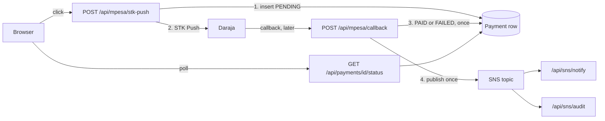
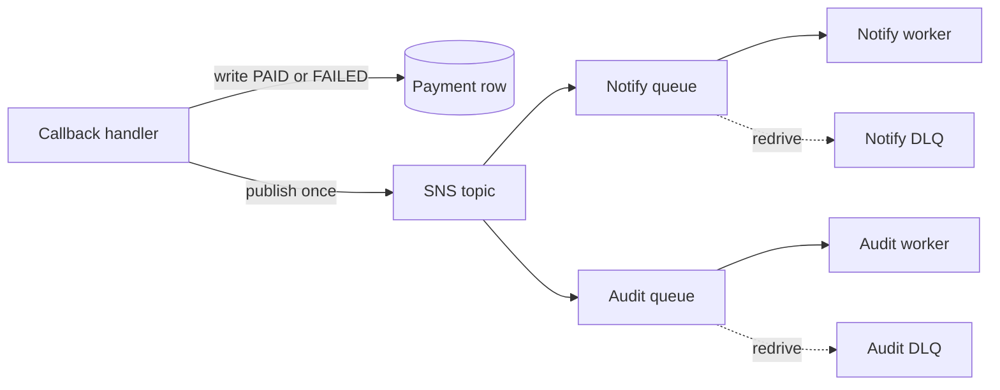

# Cloud pattern

A payment is a row first and an announcement second. Daraja confirms out of band. Once the row is `PAID` or `FAILED`, one event tells every follower. The browser only polls that row.

Call the SMS, the ledger, and the audit as functions in the same request until one of them is slow, flaky, or owned by another team. The diagrams below are the shape after that.

## Demo

What runs on stage. One Next.js app, one Postgres database, Daraja, and one SNS topic. Notify and audit are HTTPS subscriptions on that same app, so the audience can see two consumers light up without a queue.

`POST /api/payments/[id]/reconcile` is the missing-callback path. After 60 seconds the browser asks for one STK Push Query. A decisive answer updates the same row. No answer becomes `TIMED_OUT`, and a late callback can still move that row forward.

Notify stamps `notifiedAt`. Audit writes an `AuditLog`. Neither one gates the status the browser reads. If the publish fails, the handler logs it and still acknowledges Daraja. The row stays paid.

Daraja does not sign the callback. The route checks a secret in the URL, then accepts a result only for a `CheckoutRequestID` this app created. SNS does sign. Each subscriber verifies that signature before it runs.

## Production

Same publish. Each consumer gets its own SQS queue, and each queue has a dead-letter queue. A broken auditor retries on its own and does not block the SMS.

The publish still happens after the row commits. A crash in that gap can lose the announcement. The repair for that dual write is a transactional outbox: the event is written in the same transaction as the payment, and a separate publisher drains it.

## Why SNS

SNS is the fan-out. One publish, a separate delivery to each subscriber, and the callback handler does not name them. Adding audit does not change the publisher.

SQS is the buffer in front of each subscriber, with a dead-letter queue. EventBridge fits when the event needs routing rules. On day one, skip all three and call the functions.
